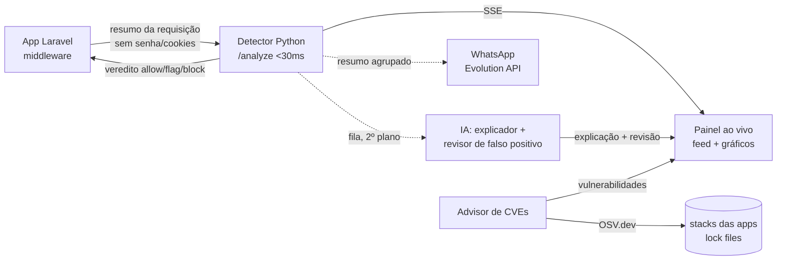

<div align="center">

# 🛡️ Sentinela

### Detecção de padrões de ataque em tempo real, com IA e modelos open source

Analisa cada requisição de um app **Laravel**, classifica o risco com um modelo treinado localmente, bloqueia na borda e mostra tudo num **painel ao vivo** — cada alerta com explicação em português e a correção recomendada.


</div>

---

## A ideia em uma linha

> **Um WAF de regex vê a assinatura. Não vê a intenção.**

Ataques ofuscados, CVEs novas de PHP e abuso de comportamento passam direto por regras estáticas. O Sentinela junta **modelo de ML + heurística de comportamento + regra estática** e, no painel, mostra o contador **"só o modelo pegou"** — o valor da camada de IA, medido na tela.

---

## O que faz

| | Capacidade | Como |
|---|---|---|
| 🎯 | **Classifica payloads** | `sqli`, `xss`, `traversal`, `cmdi`, `normal` — scikit-learn (TF-IDF char n-gram + Regressão Logística) |
| 👁️ | **Vigia comportamento por IP** | Rajadas, varredura e força bruta por janela deslizante de 60s (Isolation Forest, com limiares de fallback) |
| ⛔ | **Bloqueia na borda** | Middleware Laravel devolve `403`. *Fail-open*: detector fora não derruba o app |
| 💬 | **Explica o alerta** | LLM descreve ataque, impacto e correção em Laravel. Provedor trocável na tela |
| 🔁 | **Revisa (2ª opinião)** | LLM-as-detector: para cada alerta, diz se é ataque real ou provável **falso positivo** (nunca muda o veredito) |
| 📡 | **Antecipa CVEs** | Advisor cruza a stack das apps (lock files + `stacks.json`) com o **OSV.dev** e sugere o que atualizar |
| 📱 | **Avisa no WhatsApp** | Resumo agrupado dos bloqueios e das CVEs novas no celular do time, via Evolution API |
| 🔎 | **Chat de logs** | Perguntas em linguagem natural: *"qual IP mais atacou?"* |

---

## Arquitetura



**Stack:** Python stdlib + scikit-learn · HTML/JS + Chart.js (SSE) · middleware Laravel 10/11 · LLM OpenAI-compatível (DeepSeek, Ollama, vLLM, OpenAI, Groq…) · Evolution API.

> 🧠 **Onde a IA entra (e onde não entra):** a *detecção* é ML + heurística + regra estática (determinística, &lt;30ms). A *LLM* só **explica** o alerta e responde o **chat de logs** — ela não decide bloqueio. Detalhes em [`docs/ia.md`](docs/ia.md).

---

## Começar

```bash
cd sentinela
python3 -m venv .venv && .venv/bin/pip install -r requirements.txt
cp .env.example .env            # ajuste as variáveis

# (opcional) treinar o modelo — precisa de data/train.csv (colunas value,label)
.venv/bin/python detector/train.py

# subir API + dashboard em http://127.0.0.1:8765/
SENTINELA_API_KEY=troque-esta-chave .venv/bin/python detector/server.py
```

Sem `models/classifier.joblib` o servidor sobe **só com regras**; sem `models/anomaly.joblib` usa **limiares por IP**. O painel pede a chave (`SENTINELA_API_KEY`) na primeira abertura.

---

## Demo (menu interativo)

Um comando, escolha a cena pelo número, roda em sequência sem recomandar:

```bash
cd sentinela && ./demo/demo.sh
```

```
  1) Resetar demo         2) Payloads (SQLi/XSS/traversal/cmdi)
  8) PHP 2024 ★           9) OOM-DoS 2026 ★
  3) Scan   4) Brute   5) Flood   6) TUDO   7) Comportamento
```

---

## Cobertura de atualidade

| Ameaça | Técnica MITRE | Detecção |
|---|---|---|
| **CVE-2024-4577** — argument injection no PHP-CGI | `T1190` · `T1059` | `cmdi` (soft-hyphen, `-d`, `allow_url_include`, `auto_prepend_file`) |
| **CVE-2024-52301** — troca de ambiente no Laravel | `T1190` | `cmdi` (`--env=` via argv) |
| **PHP filter chains** — LFI→RCE | `T1190` · `T1083` | `traversal` (`php://filter`, `convert.base64`, `data://`) |
| **CVE-2026-109618** — OOM / php2shell no FPM | `T1499` | `oom` — bloqueia a memory bomb pela **borda HTTP** (tamanho do corpo) |

> O OOM cobre a superfície **HTTP**. Para o vetor via **socket FPM** (que contorna o nginx), a engenharia prevista é um *sidecar* que faz tail do log do FPM e emite o alerta `oom` ao ver `Allowed memory size exhausted`.

---

## Contrato da API

```http
POST /analyze        # veredito allow | flag | block + categoria + MITRE
POST /api/feedback   # status HTTP pós-resposta (alimenta janela por IP)
GET  /events         # Server-Sent Events: request | alert | alert_update | stats
GET  /api/alerts     # últimos alertas (também carregados do disco ao subir)
GET  /api/advisories # CVEs da stack (OSV.dev); POST /api/advisories/refresh força atualização
POST /api/chat       # pergunta em linguagem natural sobre os logs
POST /api/provider   # troca o provedor de IA em memória
GET  /health         # liveness

# Eventos SSE: request · alert · alert_update (explicação) · alert_review (2ª opinião) · stats
```

Todos os `/analyze` e `/api/*` exigem o header `X-Sentinela-Key`.

---

## Estrutura

```
sentinela/
├── detector/          # API, SSE, decisão, modelos, explicador, OOM, WhatsApp
│   ├── server.py  train.py  normalize.py  rules.py  mitre.py
│   ├── ipwindow.py  explainer.py  chatlogs.py  mask.py  wa_notify.py
│   ├── reviewer.py              # LLM-as-detector (2ª opinião / falso positivo)
│   ├── advisor.py               # CVEs da stack via OSV.dev
│   └── static/index.html        # dashboard (sem build)
├── laravel/           # middleware SentinelaGuard + config + view de bloqueio
├── demo/              # menu, gerador de tráfego e roteiro do pitch
└── tests/             # pytest (47 testes)
docs/requisitos.md     # especificação completa
```

---

## Privacidade & segurança

- O detector escuta em `127.0.0.1` por padrão; chave obrigatória em todos os endpoints.
- Senha, `_token`, cartão e **cookies** nunca saem do app (removidos no middleware).
- A IA recebe só o necessário; e-mail, CPF, telefone e cartão são mascarados antes do envio.
- Chaves (IA e WhatsApp) só por variável de ambiente — nunca em log, resposta ou dashboard.

---

## Status honesto

**Pronto:** detector, API, dashboard, chat de logs, troca de provedor, middleware Laravel, explicador, revisor de falso positivo (LLM-as-detector), advisor de CVEs por stack (OSV.dev), alertas no WhatsApp, CVEs 2024 + OOM 2026, 49 testes.

**A fazer:** treinar o modelo com `data/train.csv` real (o F1 ≥ 0,90 entra no slide) e o sidecar do log do FPM para o vetor via socket.

<div align="center">

---

Feito num hackathon · detecção de ataques com IA

</div>
